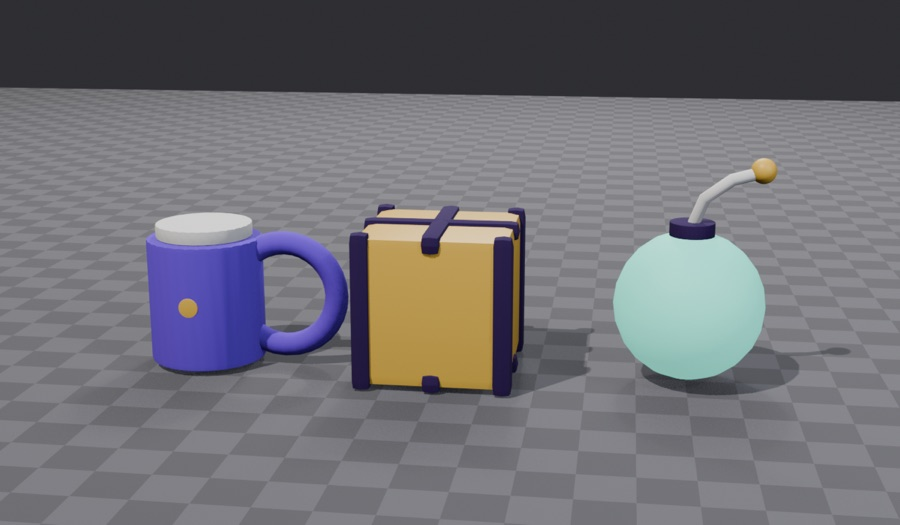
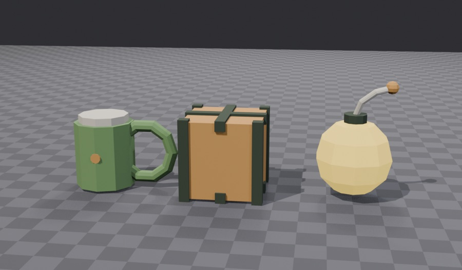
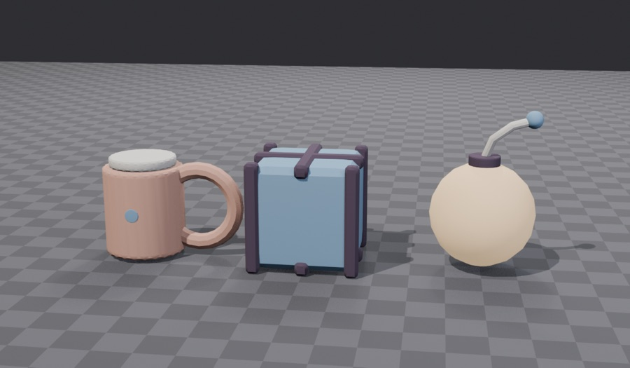
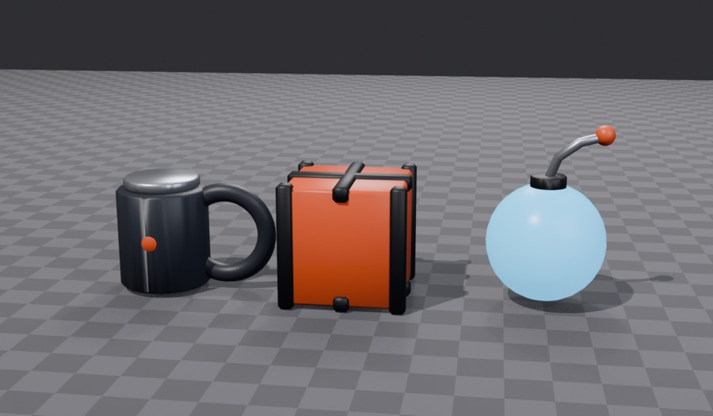
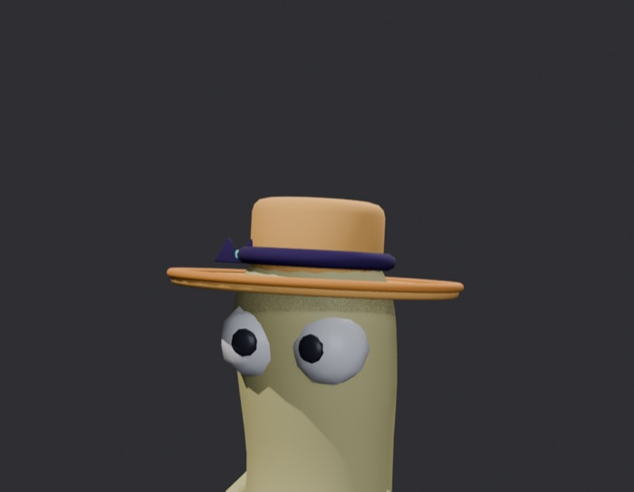
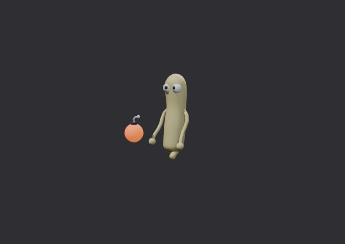

# polystory

**Model 3D game assets as code, with Blender and your AI coding agent.**
One short Python recipe per model, built headless into a GLB, checked
against your project's triangle and byte budgets, size envelopes and
palette, rendered on your rig or a turntable for review, then registered
the way your project does. A Claude Code plugin, an Agent Skill for Codex,
Cursor and the rest, and a CLI any of them can call.

```
/polystory init      the facts: where models live, units, budgets, rig and sockets, how a file is registered
/polystory style     the look: palette and bevel/shading knobs, derived from your GLBs or chosen from four rendered directions
/polystory new       a model: recipe → build → check → renders → register
/polystory doctor    can a build run here
```

| toy | faceted | clay | hard-surface |
| --- | --- | --- | --- |
|  |  |  |  |

The same calibration recipe under the four built-in directions. `style`
renders these when a project has nothing to derive a look from; you pick
one, and every model after that is built with its knobs and palette.

## Who it is for

- You are making a game or an interactive scene in three.js, React Three
  Fiber, Babylon, Godot, Unity or Unreal, and you need low-poly props,
  pickups, hats, projectiles or set pieces that all look like they belong
  together.
- You want an AI agent (Claude Code, Codex, Cursor, Gemini CLI) to make
  those models for you, but a text prompt into a 3D generator gives you
  one-off meshes with no shared style, no budgets and no way to tweak.
- You already have a few GLBs and want new ones that match them.

polystory is not a mesh generator and not for sculpted, scanned or
textured assets. It is for flat-coloured, bevelled or faceted, stylised
low-poly models, the kind a game ships hundreds of.

## How it works

1. **A recipe is code.** `recipes/bomb.py` is a dozen lines: an `ITEM`
   dict and a `build(kit)` that places cylinders, cones, spheres, boxes,
   tori and tubes, each with a palette material. The kit bevels and
   smooths every part the same way, from the project's style knobs.
2. **The build is headless Blender.** `polystory build recipes/bomb.py`
   runs `blender -b`, exports `models/bomb.glb`, prints the triangle count
   and bounds, and checks the file.
3. **The check reads the bytes.** Triangles and bytes against the kind's
   budget, bounds against the slot's envelope, every material's colour
   against the palette, no textures, no animation, the root at the origin,
   a skinned file only where the project allows it and only on the rig's
   bones. `FAIL` never ships.
4. **The renders are looked at.** `polystory preview models/bomb.glb`
   gives three views: close, on the rig (or a turntable with a scale
   figure), and from the game's viewing distance. The agent opens them,
   judges, fixes the recipe, and sends them to you before calling it done.
5. **Registration is the project's.** A command with `{id}` `{slot}`
   `{model}` placeholders, or a paragraph to follow, from the profile.

| a hat on the project's rig, with the reference beside it | a projectile from the TV camera's distance |
| --- | --- |
|  |  |

Everything project-specific is one folder, `.polystory/`, committed with
the project:

```
.polystory/profile.json   facts: kinds, folders, units, budgets, slots, rig, registration
.polystory/style.json     what the build applies: knobs and the palette
.polystory/style.md       what the modeller reads: the look in words, with the numbers
```

`init` writes the first by scanning your repo for GLBs and asking only
what it cannot see. `style` writes the other two, either by measuring
your existing files (shading, bevels, colours, budgets, all from the
bytes) or by rendering the calibration set and letting you choose.

## Install

Blender 4.2+ and node 20+ are required. `polystory doctor` tells you what
is missing.

**Claude Code, as a plugin** (the repo is its own marketplace; `claude plugin update` brings new versions):

```
claude plugin install polystory --marketplace typeWolffo/polystory
```

Or in two steps: `claude plugin marketplace add typeWolffo/polystory`, then
`claude plugin install polystory@polystory`. The skill is `/polystory:polystory`;
the plugin also installs a hook that checks any GLB a shell command writes
under a models folder.

**Any agent, as a skill** (Claude Code, Codex, Cursor, Gemini CLI, Copilot and the other agents the [skills CLI](https://skills.sh) supports):

```
npx skills add typeWolffo/polystory
```

The skill is then `/polystory`. The CLI it calls comes from npm on first
use (`npx -y polystory`).

**From npm, into Claude Code without a marketplace:**

```
npx polystory install        # copies the skill into ./.claude/skills/polystory
npx polystory install -g     # or into ~/.claude/skills/
```

**To try a checkout:** `claude --plugin-dir /path/to/polystory`.

## The CLI

```
polystory context                      the project's state, what a skill reads first
polystory doctor
polystory scan [--dirs a,b]            measure GLBs into .polystory/scan.json
polystory check [--kind k] <glb…>      may these files ship
polystory build <recipe.py>            → models/<model>.glb, then check
polystory preview <glb> [--ref <obj>]  three renders in .polystory/previews/
polystory register <recipe.py>         the kind's register command, ITEM filled in
polystory calibrate [all|<dir>|style]  the calibration set under a direction's or the project's knobs
polystory item <recipe.py>             the recipe's ITEM as JSON
polystory install [-g]                 copy the skill into .claude/skills/
polystory hook                         the PostToolUse hook body, for a hand-written settings.json
```

`npx polystory <command>` runs it without installing; `--project <root>`
points at a project from elsewhere. The checker and the scan read GLB
bytes in node with no dependencies; build, preview and calibrate run
`blender -b`.

## A recipe

```python
"""A bomb. Metres, the origin is the centre of the ball, +Z up, -Y forward."""

ITEM = {"kind": "prop", "id": "bomb", "model": "bomb"}

def build(kit):
    kit.sphere(r=0.2, mat="glow")
    kit.cylinder(r=0.07, h=0.06, z=0.17, mat="dark")
    kit.tube([(0, 0, 0.22), (0.02, -0.03, 0.3), (0.08, -0.04, 0.35)], r=0.018, mat="light")
    kit.sphere(r=0.03, x=0.09, y=-0.04, z=0.36, mat="accent")
```

Bevel width and segments, sphere resolution, smooth or flat shading come
from `style.json`; a call may override one of them with a reason. The
kit, the ITEM contract and the cost of each primitive are in
[skills/polystory/reference/recipe.md](skills/polystory/reference/recipe.md);
the schemas in [reference/profile.md](skills/polystory/reference/profile.md);
what makes a model read in [reference/craft.md](skills/polystory/reference/craft.md).

## Questions people ask

**Can Claude Code or Codex make 3D models for my game?** With polystory,
yes, within a style: the agent writes a recipe, Blender builds it, the
check and the renders keep it inside the look you set once. It will not
sculpt a dragon.

**Does it need Blender open?** No. Every build and render is `blender -b`
with `--factory-startup`; nothing is saved to any `.blend`. Blender only
has to be installed.

**Do my existing models have to be recipes?** No. `init` and `style`
read them as they are. A model without a recipe is treated as hand-made:
it gets warnings where a recipe-built file would get errors.

**Can I use my own engine or format?** The output is a standard GLB
(Y-up, no textures, one material per colour), which three.js, Babylon,
Godot, Unity and Unreal import. Registration is whatever your project
does; the profile holds the command.

**What about clothes, skinned meshes, animations?** Out of scope for a
recipe. The check knows about skinned files so a project that makes them
elsewhere can still have them checked against the rig.

**Why recipes instead of a 3D generator?** Repeatability and a style
that holds across hundreds of files. A generator gives you a different
mesh every time and no way to say "the same hat, brim 10% wider".

## Repository layout

```
.claude-plugin/          plugin.json, marketplace.json (the repo is its own one-plugin marketplace)
skills/polystory/        SKILL.md, reference/ (init, style, new, doctor, profile, recipe, craft), templates/
scripts/                 polystory.mjs (CLI), check, scan, context, doctor, hook; lib/ (profile, glb); blender/ (toolkit, build, preview, calibrate, render)
hooks/                   hooks.json (the plugin's PostToolUse hook)
test/                    node --test; the Blender test skips when Blender is missing
docs/                    the renders in this README
```

## Status and roadmap

- **Now**: the engine, the profile/style split, `init` by scan and
  interview, `style` by derivation or a calibration throw, `new`,
  `doctor`, the hook, the three install routes.
- **Next**: a local review page. A few lines of Python serve a three.js
  viewer; you drop pins on the mesh with a note, each pin carries the
  camera pose and a screenshot, and they come back to the agent as fix
  requests. No upload, no account.

MIT. Issues and recipes welcome.
